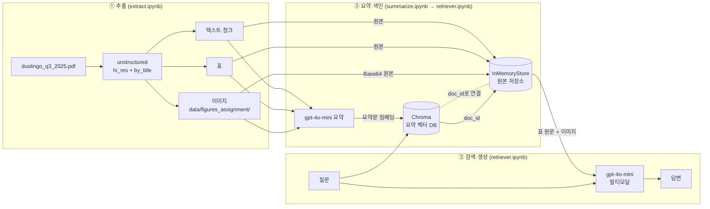
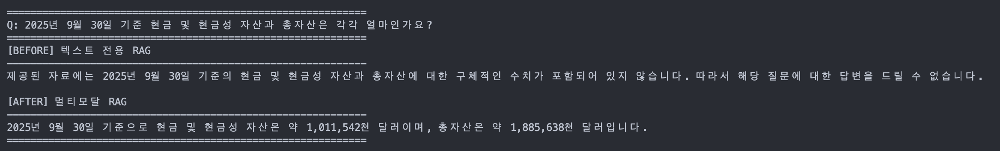

# Multimodal RAG — 듀오링고 Q3 2025 주주서한 Q&A

듀오링고(Duolingo) 2025년 3분기 주주서한 PDF에서 **텍스트·표·이미지를 모두 추출**하고,
각각을 요약해 검색한 뒤 **원본(표 원문·이미지)을 멀티모달 LLM에 넘겨** 답을 생성하는 RAG 파이프라인입니다.

---

## 1. 문제 정의

- **자료**: `data/duolingo_q3_2025.pdf` — Duolingo Q3 2025 Shareholder Letter (영문, 약 25쪽)
- **자료의 특성**: 본문은 서술과 하이라이트 위주이고, **핵심 수치는 표와 그래프에 몰려 있습니다.**
  재무상태표·현금흐름표·Non-GAAP 조정표·4분기 가이던스 같은 표는 본문에 숫자가 다시 나오지 않습니다.
  사용자 지표(DAU/MAU/유료 구독자)와 재무 지표도 그래프 이미지로 제공됩니다.
- **문제**: 텍스트만 임베딩하는 일반 RAG는 이런 질문에 답하지 못합니다.
  _"9월 30일 기준 총자산은?"_ 같은 질문을 하면 근거가 검색되지 않아 "알 수 없음"이 나옵니다.
- **목표**: 표와 이미지도 검색 대상에 넣어서, **표·그래프를 봐야만 답할 수 있는 질문**에 근거 있는 답을 내는 것

## 2. 아키텍처



| 단계        | 하는 일                                                                        | 산출물                                      |
| ----------- | ------------------------------------------------------------------------------ | ------------------------------------------- |
| ① 추출      | PDF를 텍스트 청크·표·이미지로 분리                                             | `extracted.pkl`, `figures_assignment/*.jpg` |
| ② 요약·색인 | 요소마다 검색용 요약을 만들어 벡터 DB에 넣고, 원본은 같은 `doc_id`로 따로 보관 | `summaries.pkl`, Chroma + InMemoryStore     |
| ③ 검색·생성 | 질문과 비슷한 **요약**을 찾고 `doc_id`로 **원본**을 꺼내 LLM에 전달            | 답변                                        |

## 3. 구조 이해 — 왜 "요약으로 검색하고, 원본으로 생성"하는가

<!-- ✏️ 채점 기준이 "본인 말로 설명"이므로, 아래 내용을 참고해서 직접 쓴 문장으로 다듬어 주세요. -->

- **이미지는 그대로 임베딩해 검색할 수 없습니다.** 텍스트 임베딩 모델은 이미지를 벡터로 못 바꿉니다.
  그래서 이미지를 먼저 글로 요약해야 질문과 같은 공간에서 비교할 수 있습니다.
- **표 원문은 검색하기에 지저분합니다.** `(in thousands) ASSETS Cash and cash equivalents ...`처럼 숫자와 항목명이 뒤섞여 있습니다.
  이런 원문보다 "2025년 9월 30일 기준 자산 현황: 현금 및 현금성 자산…" 같은 요약이 질문 문장과 의미가 더 가깝게 잡힙니다.
- **그런데 답은 요약으로 만들면 안 됩니다.** 요약은 숫자를 빠뜨리거나 뭉뚱그립니다.
  그래서 검색은 요약으로 하고, 답할 때는 `doc_id`로 **원본 표 전체와 원본 이미지**를 꺼내 LLM이 직접 보게 합니다.
- 비유하면 요약은 도서관의 **색인 카드**, 원본은 **서가의 책**입니다. 카드로 찾고, 읽는 건 책으로 합니다.
  이 연결을 해 주는 것이 `MultiVectorRetriever`의 `id_key="doc_id"`입니다.

## 4. 기술 선택 근거

| 항목                  | 선택                                                                                                                                                   | 이유                                                                                                                                                                                                                       |
| --------------------- | ------------------------------------------------------------------------------------------------------------------------------------------------------ | -------------------------------------------------------------------------------------------------------------------------------------------------------------------------------------------------------------------------- |
| PDF 파싱              | `unstructured` `strategy="hi_res"` + `infer_table_structure=True` + `extract_image_block_types=["Image"]`                                              | 표를 구조째 읽고 이미지를 파일로 떼어내려면 레이아웃 분석이 필요합니다. `fast`로는 표가 일반 텍스트로 섞입니다.                                                                                                            |
| 텍스트 청크           | `by_title`, `max_characters=4000`, `new_after_n_chars=3800`, `combine_text_under_n_chars=2000`, 이후 `chunk_size=2000`, `chunk_overlap=200`으로 재분할 | 주주서한은 소제목 단위로 주제가 바뀌어서 제목 기준 분할이 자연스럽습니다. 짧은 조각은 합치고, 너무 긴 블록은 약 2천 자로 다시 나눠 요약 품질과 토큰 비용을 맞췄습니다. overlap 200은 문장이 경계에서 잘리는 것을 막습니다. |
| 요약·생성 모델        | `gpt-4o-mini` (temperature=0)                                                                                                                          | 교재의 `gpt-4`보다 싸고 빠르면서 **이미지 입력을 지원**합니다. 요약과 답변이 매번 달라지지 않도록 temperature 0을 썼습니다.                                                                                                |
| 임베딩                | `text-embedding-3-small`                                                                                                                               | 요약문이 짧고 문서 수가 22건이라 small로 충분합니다. 비용도 가장 낮습니다.                                                                                                                                                 |
| 벡터 DB / 원본 저장소 | Chroma / InMemoryStore                                                                                                                                 | 로컬에서 서버 없이 바로 쓸 수 있습니다. 과제 규모에서는 영속화가 필요 없습니다.                                                                                                                                            |
| 프롬프트 언어         | 표·텍스트 요약: **한국어** 프롬프트 / 이미지 요약: 영어 지시 + "한국어로 작성" / 최종 답변: 한국어                                                     | 질문을 한국어로 하므로 요약도 한국어여야 임베딩 공간에서 질문과 가깝게 잡힙니다. 이미지 설명은 영어 지시를 더 잘 따라서 지시는 영어로 하고 출력만 한국어로 받았습니다.                                                     |

## 5. 결과

### 질의 5건 (`src/retriever.ipynb` 7-2)

모두 표나 그래프에만 있는 수치를 묻는 질문입니다. 답은 원본 PDF의 표 값과 대조해 확인했습니다.

| #   | 질문                                                 | 근거                  | 답변                                                |
| --- | ---------------------------------------------------- | --------------------- | --------------------------------------------------- |
| 1   | 2025년 9월 30일 기준 현금 및 현금성 자산과 총자산은? | 재무상태표            | 현금 $1,011,542천, 총자산 $1,885,638천              |
| 2   | 2025년 4분기 매출·조정 EBITDA 가이던스는?            | 가이던스 표           | 매출 $273M–$277M, 조정 EBITDA $75.4M–$78.8M         |
| 3   | 3분기 자유현금흐름과 마진은 전년 대비 어떻게 변했나? | FCF 조정표            | $51,244천 → $77,356천, 마진 26.6% → 28.5%           |
| 4   | 3분기 DAU·MAU·유료 구독자와 전년 대비 성장률은?      | 사용자 지표 표·그래프 | DAU 50.5M(+36%), MAU 135.3M(+20%), 유료 11.5M(+34%) |
| 5   | 3분기 GAAP·Non-GAAP 연구개발비는?                    | R&D 조정표            | GAAP $82,707천, Non-GAAP $55,281천                  |

### Before / After

같은 질문, 같은 모델, 같은 프롬프트를 쓰고 **검색 대상만 다르게** 한 비교입니다.



```text
============================================================
Q: 2025년 9월 30일 기준 현금 및 현금성 자산과 총자산은 각각 얼마인가요?
============================================================
[BEFORE] 텍스트 전용 RAG
------------------------------------------------------------
제공된 자료에는 2025년 9월 30일 기준의 현금 및 현금성 자산과 총자산에 대한
구체적인 수치가 포함되어 있지 않습니다. 따라서 해당 질문에 대한 답변을 드릴 수 없습니다.

[AFTER] 멀티모달 RAG
------------------------------------------------------------
2025년 9월 30일 기준으로 현금 및 현금성 자산은 약 1,011,542천 달러이며,
총자산은 약 1,885,638천 달러입니다.
============================================================
```

#### 차이가 나는 이유

- BEFORE는 본문 텍스트 청크만 검색합니다. 재무상태표 숫자는 본문에 없어서 근거를 찾지 못하고 "알 수 없음"으로 답합니다.
  환각 없이 모른다고 한 점은 프롬프트가 의도대로 동작한 것입니다.
- AFTER는 표 요약("2024년 12월 31일과 2025년 9월 30일 기준 자산 및 부채 현황…")이 질문과 매칭됩니다.
  그 `doc_id`로 **재무상태표 원문**을 꺼내 LLM에 넘기기 때문에 정확한 수치로 답합니다.

## 6. 한계점

- 추출된 이미지 7장 중 4장은 로고·캐릭터·서명처럼 정보가 없는 이미지입니다. 크기나 내용으로 걸러내면 색인 품질이 더 좋아집니다.
- InMemoryStore와 Chroma 인메모리 컬렉션을 쓰기 때문에, 커널을 재시작하면 색인을 다시 만들어야 합니다.

## 7. 보안 처리

- API 키는 `.env`에만 두고 `.gitignore`로 제외합니다. 저장소에는 키가 없는 템플릿 `.env.example`만 올립니다.
- 노트북에서는 키 값을 일부라도 출력하지 않고 `API 키 로드 완료`만 출력합니다.
- `.gitignore`에서 제외하는 것: `.env`, `.venv/`, 추출 산출물(`data/figures*/`, `data/processed*/`), `chroma_db/`, 캐시·에디터 파일

## 8. 프로젝트 구조

```text
multimodal-rag/
├── .env.example            # 키 없는 템플릿
├── .gitignore
├── requirements.txt
├── requirements.lock.txt
├── README.md
├── data/
│   ├── duolingo_q3_2025.pdf      # 과제 자료 (본인 선정)
│   ├── invest*.pdf               # 실습 자료
│   ├── figures_assignment/       # 과제 추출 이미지 (Git 제외)
│   └── processed_assignment/     # 과제 추출·요약 결과 pkl (Git 제외)
├── notebooks/              # 수업 실습
│   ├── 01_데이터추출__연습본.ipynb
│   ├── 02_요약생성_학습.ipynb
│   ├── 03_임베딩_최종체인_연습.ipynb
│   └── multi_modal_RAG.ipynb
└── src/                    # 과제
    ├── extract.ipynb       # ① PDF 파싱
    ├── summarize.ipynb     # ② 요약 생성
    └── retriever.ipynb     # ②③ 다중 벡터 검색기 + 최종 체인
```

## 9. 실행 방법

```bash
git clone https://github.com/SeoHyun1024/multimodal-rag.git
cd multimodal-rag

# 가상환경 생성 및 활성화
python -m venv .venv
source .venv/bin/activate        # 윈도우: .venv\Scripts\activate

# 의존성 설치
pip install --upgrade pip
pip install -r requirements.txt  # 또는 requirements.lock.txt

# 커널 등록
python -m ipykernel install --user --name multimodal-rag

# .env 작성 후 실제 API 키 입력
cp .env.example .env             # 윈도우: copy .env.example .env
```

이후 `src/extract.ipynb` → `src/summarize.ipynb` → `src/retriever.ipynb` 순서로 실행합니다.
